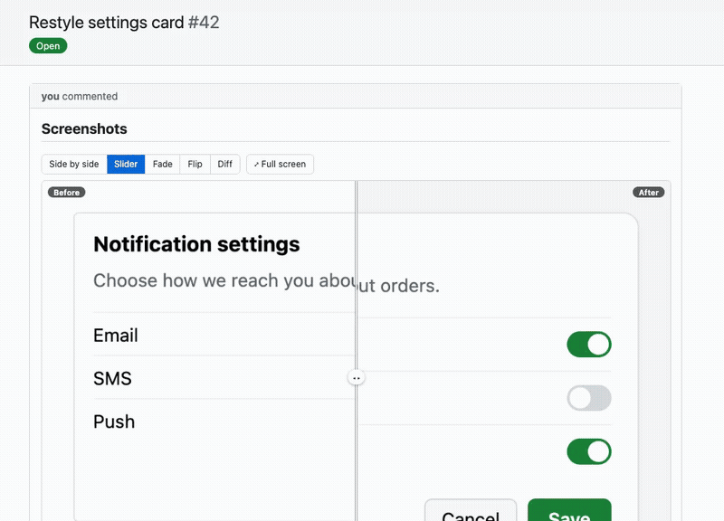

# Before/After Compare

A Chrome extension for reviewing frontend pull requests. It turns the `| Before | After |` screenshot
tables in GitHub PRs and issues into one comparison you can **slide**, **fade**, **flip** or **diff**,
instead of squinting at two thumbnails side by side.



## What it does

- **Slider**: drag a divider across the two screenshots, stacked at the same scale.
- **Fade**: cross-fade one into the other.
- **Flip**: click or press Space to blink between them; anything that moved jumps.
- **Diff**: only changed pixels light up, red where Before had something, green where After does.
- **Full screen**: one pair at a time, ← → through every pair in the PR, 1–4 to switch modes, Esc to close.
- **Side by side** brings back GitHub's own table, which is never modified, only hidden.

Your chosen mode sticks across tables and PRs. Recordings (videos) get a Play button that starts both in
step.

## Which tables it picks up

Any table in a comment whose headers start with `Before` and `After`, with an image or video in each cell.
Extra columns (e.g. `Viewport`, `Theme`) become labels, and a single italic line right under the table
becomes the caption in full screen:

```markdown
| Before | After |
| --- | --- |
|  |  |

_Save button overflowed the toolbar on 375px screens; it now wraps below the title._
```

## Install

From a [release](../../releases) zip, until the Chrome Web Store listing is live:

1. Download and unzip `before-after-compare-<version>.zip`; keep the folder somewhere permanent.
2. Open `chrome://extensions`, turn on **Developer mode** (top right).
3. **Load unpacked** → pick the `before-after-compare` folder. Refresh any open GitHub tabs.

Works in Chrome, Edge, Brave, Arc and other Chromium browsers.

## How the diff works

GitHub serves uploaded images without CORS headers, so a canvas can't read their pixels. The browser's
compositor can still blend them: in an isolated group, `lighten` then `difference` leaves
`max(0, other − this)` per channel, which an SVG `feColorMatrix` turns into a red or green overlay whose
opacity grows with the difference, dilated 1px so hairline changes stay visible.

## Privacy

No permissions beyond running on `github.com`, no network requests, no analytics. The only thing stored
is your last chosen mode, in the page's `localStorage`. See [PRIVACY.md](PRIVACY.md).

## Develop

```sh
npm install
npm run build     # or: npm run watch
npm run package   # → release/before-after-compare-<version>.zip
```

Reload the extension on `chrome://extensions` and refresh the GitHub tab after a build. Bump `version` in
both `manifest.json` and `package.json` before packaging. `store/` holds the Chrome Web Store listing text
and images.

## License

[MIT](LICENSE)
